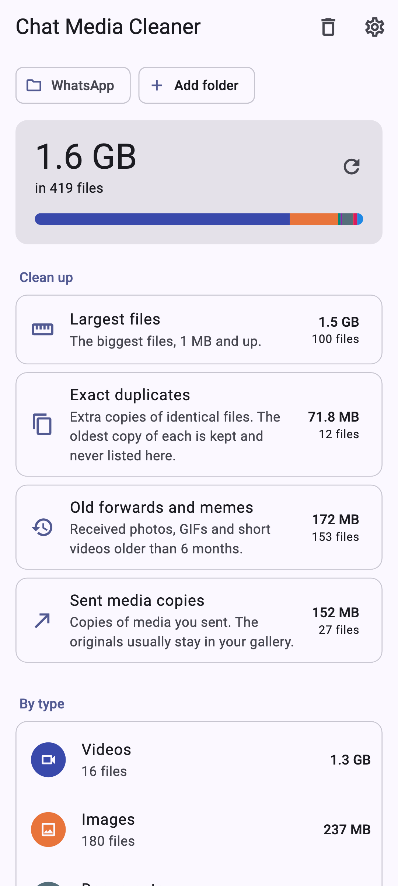
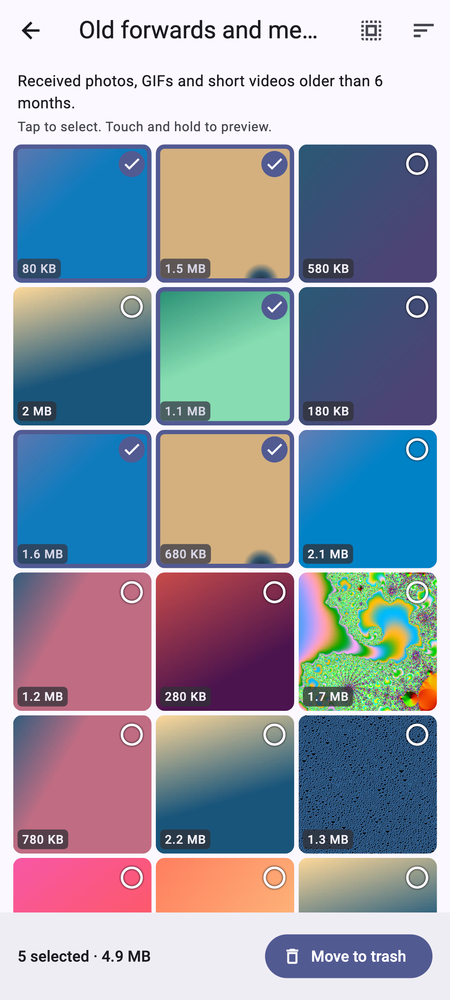
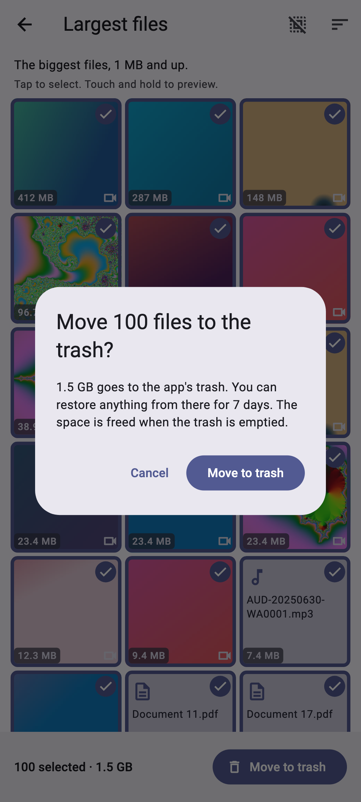
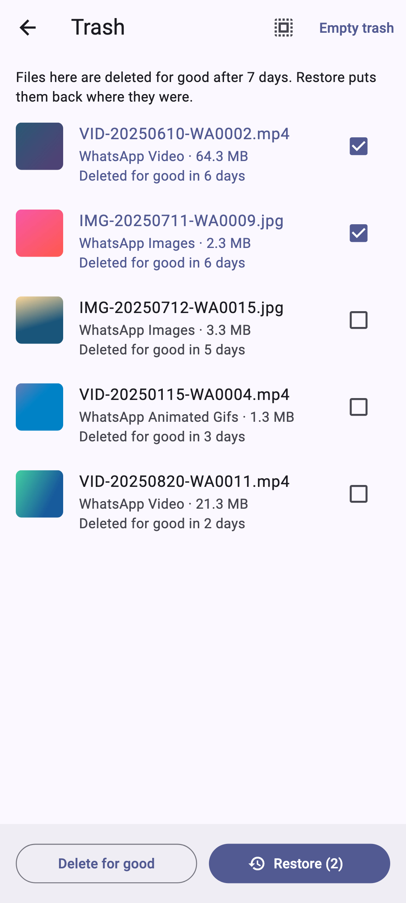

# Chat Media Cleaner

[](https://github.com/ChandraChaan/chat-media-cleaner/actions/workflows/ci.yml)
[](https://github.com/ChandraChaan/chat-media-cleaner/releases/latest)
[](https://github.com/ChandraChaan/chat-media-cleaner/releases)

[](LICENSE)

**See which WhatsApp photos, videos and voice notes are filling your phone, and clear them safely.**

Chat Media Cleaner scans the WhatsApp (and WhatsApp Business) media folder, shows what takes the most space, and groups the files you probably don't need: huge videos, the same meme saved five times, old forwards, copies of things you sent. You pick what goes. Deleted files wait in a trash for 7 days so you can change your mind. No internet permission, no account, no ads.

<p align="center">
  
  
  
  
</p>

## Download

**[Download the latest APK →](https://github.com/ChandraChaan/chat-media-cleaner/releases/latest)**

| File | For |
|---|---|
| `ChatMediaCleaner-<version>-arm64-v8a.apk` | Almost every phone from the last 6–7 years (pick this if unsure) |
| `ChatMediaCleaner-<version>-armeabi-v7a.apk` | Older 32-bit phones |
| `ChatMediaCleaner-<version>-universal.apk` | Any phone (bigger download) |

Open the file on your phone and allow installing from your browser or file manager when Android asks. Each release lists SHA-256 checksums, and every APK is signed with the same release key, so future versions install as updates.

## How to use it

1. Open the app and tap **Choose WhatsApp folder**. Android's file picker opens at the right place; tap **Use this folder**, then **Allow**.
2. Tap **Scan now**. The scan lists the folder, then compares files of the same size to find exact duplicates. You get the total, a breakdown by type (videos, images, voice notes, documents, stickers, GIFs, statuses) and the clean-up groups.
3. Open a group, tap the files you want gone (touch and hold to preview), and tap **Move to trash**.
4. Delete them right away to free the space, or leave them in the trash. Anything still there after 7 days (you can pick 1 to 30) is deleted for good the next time you open the app.

## What it finds

| Group | What's in it |
|---|---|
| **Largest files** | The 100 biggest files of 1 MB or more, biggest first. |
| **Exact duplicates** | Files with exactly the same content (same size, then the same SHA-256 hash), like a video forwarded to you in three groups. The oldest copy of each is kept and never listed, so even "Select all" leaves one. |
| **Old forwards and memes** | Photos, GIFs and short videos (up to 16 MB) you *received* more than 6 months ago (3, 6, 12 or 24 in Settings). Voice notes, documents and things you sent are never in this group. |
| **Sent media copies** | Files in WhatsApp's `Sent` folders: copies of media you sent, whose originals usually stay in your gallery. |
| **By type** | Every file of one type, for example all statuses or all documents. |

## Why it asks for a folder

Since Android 11, an app can't read another app's media folder on its own. Instead of asking for *All files access*, Chat Media Cleaner uses Android's own folder picker (the Storage Access Framework): you choose `Android/media/com.whatsapp/WhatsApp/Media` once, and the app gets access to **that folder only**. You can take the access back any time in the app's Settings or in Android's settings.

On Android 10 and older the folder is `WhatsApp/Media` at the top of your storage; the app accepts that layout too, and the WhatsApp Business folder (`com.whatsapp.w4b`).

The app has **no storage permission and no `MANAGE_EXTERNAL_STORAGE`** in its manifest.

## Privacy

- **No internet permission.** The app can't send anything anywhere, and has no analytics, ads or crash reporting.
- A scan reads file names, sizes and dates. Photos and videos are only opened to draw thumbnails and previews on screen.
- Settings and the trash list are stored in the app's private storage on your phone.

## Safety

- **Nothing is deleted unless you select it** and confirm. Groups are suggestions; nothing is pre-selected.
- **Trash first.** "Move to trash" moves files into a hidden `.media-cleaner-trash` folder inside the media folder you chose, with a `.nomedia` file so galleries ignore it. Moving is instant and needs no extra space. **Restore** puts each file back in its original folder under its original name (or a numbered name if that name was taken meanwhile).
- **Space is freed when the trash is emptied:** right after moving (if you choose *Delete now*), from the trash screen, or automatically once the restore window (7 days by default) has passed. The automatic clean-up runs when you open the app.
- Deleting a file here removes it from your phone. WhatsApp will show those messages without their media, exactly as if you'd deleted the files in a file manager.

## Not affiliated

Chat Media Cleaner is an independent open-source app. It is not made by, affiliated with or endorsed by WhatsApp or Meta. "WhatsApp" is used only to say which folder the app works with.

## Feedback

Found a file in the wrong group, or a phone where the folder picker doesn't open in the right place? [Open an issue](https://github.com/ChandraChaan/chat-media-cleaner/issues) with your phone model and Android version, or share ideas in [Discussions](https://github.com/ChandraChaan/chat-media-cleaner/discussions).

## For developers

Flutter app with a small Kotlin layer for folder access. Pull requests are welcome; [AGENTS.md](AGENTS.md) has the project rules.

### How it works

| Layer | What it does |
| --- | --- |
| [`StorageChannel.kt`](android/app/src/main/kotlin/dev/chandra/chat_media_cleaner/storage/StorageChannel.kt) | Storage Access Framework on background threads: folder picker with a persisted grant, listing folders (`DocumentsContract` queries), streaming SHA-256 of a file, thumbnails (provider thumbnail, video frame or sampled decode), moving files into and out of the trash (`moveDocument`, so no copying), opening a file in another app. |
| [`MediaStorage`](lib/features/media/domain/media_storage.dart) | The Dart interface over that platform code; tests use an in-memory fake file tree. |
| [`SourceLocator`](lib/features/media/domain/media_source.dart) | Knows the modern and legacy WhatsApp / WhatsApp Business paths, opens the picker in the right place and finds the `Media` folder inside whatever was picked. |
| [`MediaScanner`](lib/features/media/domain/media_scanner.dart) | Walks the folder tree with progress and cancel, skipping the trash and `.nomedia` files. |
| [`DuplicateFinder`](lib/features/media/domain/duplicate_finder.dart) | Groups files by size, hashes only those that share a size (SHA-256 in Kotlin, two at a time), groups by hash within each folder, keeps the oldest of each set. Sets are re-checked whenever files are trashed or restored, so one copy always stays. |
| [`MediaClassifier`](lib/features/media/domain/media_type.dart) / [`MediaAnalyzer`](lib/features/media/domain/media_report.dart) | Type from the WhatsApp folder name (with a MIME fallback), totals by type, and the smart groups and age rule. |
| [`TrashRepository`](lib/features/trash/domain/trash_repository.dart) | Trash bookkeeping: move, restore (with name clashes and missing folders), delete for good, expiry. The index is a JSON file in app storage. |
| Flutter UI | Riverpod 3 controllers per screen; folder explainer, home, review grid, preview, trash and settings; light and dark themes. |

### Build and test

Requirements: Flutter 3.44+, JDK 17, Android SDK.

```bash
flutter pub get
flutter analyze
flutter test                                        # Dart unit and widget tests
(cd android && ./gradlew :app:testDebugUnitTest)    # Kotlin tests
flutter build apk --release --split-per-abi
```

README screenshots and the launcher icon are rendered by tests with fake data:

```bash
flutter test --run-skipped --tags tools --update-goldens test/tools
dart run flutter_launcher_icons
```

#### Release signing

`android/app/build.gradle.kts` reads `android/key.properties` (git-ignored):

```
storeFile=keystore/chat-media-cleaner-release.jks
storePassword=…
keyAlias=chatmediacleaner
keyPassword=…
```

Without that file, release builds fall back to the debug key so the project still builds anywhere. Never commit the keystore or the properties file; both are in `.gitignore`.

## License

[MIT](LICENSE)
